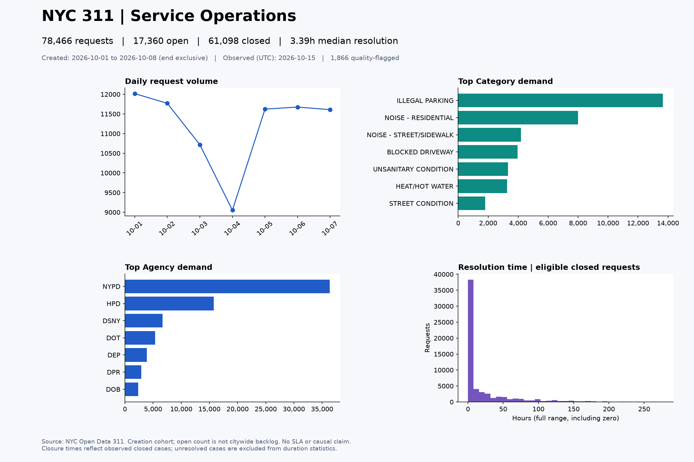
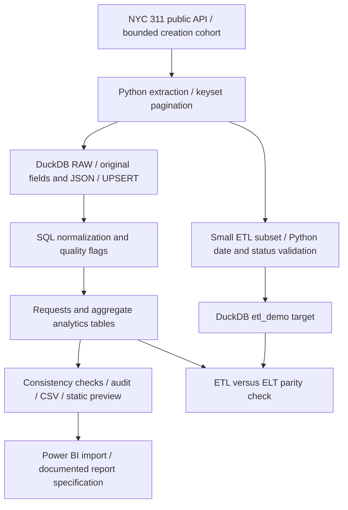

# Service Operations Analytics Pipeline

[](https://github.com/RansiJ/service-operations-analytics-pipeline/actions/workflows/ci.yml)

A reproducible **Python + SQL + DuckDB** pipeline that turns a bounded cohort of real NYC 311 requests into operational metrics and Power BI-ready CSV datasets. SQL performs the main ELT transformations; a small Python ETL example demonstrates the difference and checks equivalent results.

**Verified local result:** 78,466 requests created October 1–7, 2026; 38 automated tests; zero ETL/ELT mismatches in a 1,000-request comparison. See [actual results](docs/results.md) for observation time, denominators and verification evidence.



*This image is a Matplotlib preview. A native Power BI report has not been built.*

## Business problem

An operations analyst needs to understand incoming demand, which agencies and categories receive requests, how many cohort requests remain open, and how observed closure times vary. Source inconsistencies must be visible before interpreting the indicators.

This project answers those questions for a **creation-date cohort**, not for the entire NYC backlog. It does not define official targets or SLAs, rank agency effectiveness, or infer causes from request counts.

## Data source

- [NYC Open Data: 311 Service Requests from 2020 to Present](https://data.cityofnewyork.us/Social-Services/311-Service-Requests-from-2020-to-Present/erm2-nwe9)
- [Public JSON endpoint](https://data.cityofnewyork.us/resource/erm2-nwe9.json)
- [Socrata API documentation](https://dev.socrata.com/) and [system-field semantics](https://dev.socrata.com/docs/system-fields.html)

The live endpoint and metadata schema were verified on October 14, 2026 in Costa Rica. Relevant fields are selected explicitly; addresses, coordinates and resolution narratives are not downloaded. Source business dates are floating NYC local timestamps. Audit and source-update timestamps use UTC.

The API exposes `:updated_at`, preserved as `source_updated_at`. It is an ingestion timestamp and is not treated as a precise operational change timestamp: Socrata documents that a full dataset replacement may update all rows. `resolution_action_updated_date` is also preserved, but is not assumed to capture every record change. See [API verification evidence](docs/evidence/api_verification.json).

## Architecture



Extraction fails before downloading rows if the source count exceeds the configured cap. Requests use ascending **text** `unique_key` keyset pagination, not offset pagination. Counts before and after extraction, key monotonicity and schema checks detect incomplete or inconsistent reads. Three attempts, bounded backoff, and connect/read timeouts handle transient failures. API calls do not provide snapshot isolation; count checks cannot detect every concurrent edit.

RAW loads, SQL transformations, model checks and staged exports run inside a DuckDB transaction. Failures roll back data changes and retain a failed run audit. Successful output directories are immutable and named by run UUID; `outputs/latest.json` points to the most recently published directory. Filesystem publication and the database commit are separate operations: check `pipeline_runs.status` after a filesystem error. One writer at a time is supported.

### Controlled refresh and idempotence

Every run rereads its entire bounded creation window and UPSERTs RAW by `unique_key`. This captures changed statuses and late arrivals inside that window without an unbounded global update scan. `run_members` defines exact current-run membership, so older RAW rows do not leak into the current analytics tables. Analytics tables represent **only the latest modeled cohort**, while RAW keeps the latest observed payload for each ID encountered locally.

The same input produces identical business metrics and aggregate CSVs; observation timestamps and run IDs intentionally change. A different live-source snapshot can legitimately change results. Older windows must be explicitly refreshed to capture later closures. RAW is not a full change-history archive. Audit tables and local output folders accumulate until the user archives or removes them; they are excluded from Git.

## ETL vs. ELT implementation

| Approach | Implemented order | Benefit | Limitation / suitable use |
|---|---|---|---|
| Main ELT | Extract → load original strings and JSON → SQL transform/validate | Retains source evidence and keeps analytics logic in SQL | Requires storage and database transformation support; useful for auditable analytics |
| Small ETL demo | Reuse extracted subset → Python parse dates, classify status, flag date/status issues → load `etl_demo` | Validates a compact target before insertion | Earlier rules can discard context unless rejects are preserved; useful for constrained targets or required pre-load validation |

ETL uses at most 1,000 requests by default (configurable up to 5,000), ordered by source ID. It is a teaching subset, not a representative sample. It deliberately covers only date/status fields and resolution duration; it does not duplicate all category models or reporting. Every pipeline run compares ETL dates, lifecycle and resolution hours against ELT for the same IDs. Tests also compare total, open count and median on an identical deterministic subset.

## Tech stack

Python 3.12, DuckDB SQL, Requests, Matplotlib, pytest, uv, Git and GitHub Actions. CSV is the Power BI interchange format. No cloud database, orchestration server or paid service is required. `uv.lock` fixes dependency versions; wheel builds include SQL resources. `tzdata` supplies Windows timezone data.

## Repository structure

```text
.github/workflows/        Offline CI and bounded live refresh
src/service_analytics/
  extract.py             HTTP retries, bounds and pagination
  pipeline.py            RAW load, orchestration, QA, audits and CSV export
  etl.py                 Small Python-before-load demonstration
  schema.sql             RAW, membership, rejection and run audit tables
  transform.sql          SQL models, metrics and quality rules
  preview.py             Static analytical preview
tests/                   Small deterministic fixtures and mocked API responses
docs/
  data_dictionary.md     Fields, quality rules and metric denominators
  power_bi.md            Import, DAX, relationships and report layout
  results.md             Measured results and interpretation limits
  evidence/              Small aggregate snapshots and verified preview
data/                    Local DuckDB file (ignored)
outputs/                 Per-run CSVs, summary and preview (ignored)
```

## Setup and execution

Install Python 3.12 and [uv](https://docs.astral.sh/uv/getting-started/installation/), then run from the project directory:

```shell
uv sync --frozen
uv run --frozen pytest
uv run --frozen service-analytics --start 2026-10-01 --end 2026-10-08
```

The start date is inclusive and the end date exclusive. Allowed windows are 1–31 days. The default cap is 100,000 rows and the hard maximum is also 100,000; exceeding it fails rather than returning a truncated sample. The API is public and needs no token for this bounded usage.

```shell
uv run --frozen service-analytics --start 2026-10-01 --end 2026-10-03 --max-records 25000 --page-size 5000 --etl-sample-size 500
```

Without dates, the CLI extracts the single NYC calendar day **before yesterday**, allowing some source publication lag. This is not a guarantee that the source is complete. Logs go to standard error; the final JSON includes the output path, audit counts, metrics and CSV hashes. To inspect a past run, open its `run_summary.json` and consult the local `pipeline_runs` table.

To keep the environment outside this project on PowerShell, optionally set `UV_PROJECT_ENVIRONMENT` to an external directory before `uv sync`. The default `.venv` is already ignored. Do not commit generated databases, row-level datasets or credentials.

## Data quality and testing

Requests with usable IDs are retained even if dates, status, agency or category are problematic. Missing IDs are quarantined in `raw_rejections` with original JSON. In-batch duplicates use the last payload and are counted; API pagination rejects duplicate IDs. A request can have multiple quality flags. Normalized labels collapse whitespace and use uppercase without merging different business categories.

The deterministic test suite covers extraction, keyset pagination, caps, transient/non-transient HTTP failures, timeouts, source count drift, missing data, malformed dates, duplicates, normalization, flags, metric denominators, zero-volume days, ETL/ELT parity, UPSERT changes, membership, repeatability and rollback. Offline end-to-end tests compare byte-identical aggregate CSVs across reruns. Tests never require a live API. The live run is separate [recorded evidence](docs/results.md).

Checks enforce unique model IDs, correct RAW/model counts, status and quality partitions, nonnegative eligible durations, and reconciliation of agency/category/daily totals. Quality flags warn without silently removing rows. An empty cohort emits a processing warning. A daily volume review marker requires seven prior days and volume at least 1.5 times their mean; it is a descriptive heuristic, not a statistical anomaly model. The seven-day recorded run has insufficient baseline for that marker.

## Analytics outputs

| File | Grain / purpose |
|---|---|
| `requests.csv` | One current-cohort request; filters and recalculable KPIs |
| `metrics.csv` | One row of cohort-wide counts, median and quality rate |
| `daily_metrics.csv` | One row per requested day, including zero-volume dates |
| `category_metrics.csv` | One row per normalized category |
| `agency_metrics.csv` | One row per normalized agency |
| `quality_issues.csv` | One row per triggered rule |
| `request_quality_flags.csv` | One request/rule pair; preserves overlapping issues |
| `etl_demo.csv` | Limited ETL target for explanation and comparison |
| `run_summary.json` | Provenance, counters, warnings, parity results and CSV hashes |
| `dashboard_preview.png` | Static visual preview of real results |

Full [data dictionary and metric definitions](docs/data_dictionary.md) and [Power BI instructions](docs/power_bi.md) accompany these outputs. No `.pbix` file is supplied. The Git repository contains only small aggregate evidence, not the full row-level export.

## Actual results

Real requests created October 1–7, 2026, observed October 14 in Costa Rica (October 15 UTC):

| Indicator | Result |
|---|---:|
| Extracted / loaded requests | 78,466 / 78,466 |
| Open / closed / unknown status | 17,360 / 61,098 / 8 |
| Eligible resolution intervals | 61,053 |
| Median observed resolution | 3.3908 hours |
| Requests with quality flags | 1,866 (2.3781%) |
| Missing-ID rejections / duplicate inputs | 0 / 0 |
| ETL/ELT subset mismatches | 0 of 1,000 |

The largest category was **ILLEGAL PARKING (13,664)** and the largest agency by request count was **NYPD (36,351)**. These are demand counts, not effectiveness scores. The most frequent rule was `open_with_closed_date` (1,813 requests). See [results and repeat-run verification](docs/results.md) and [small actual CSV outputs](docs/evidence/).

## Automation

- **CI:** push to `main`, pull requests and manual execution; Python 3.12 on Linux and Windows; locked dependencies, offline tests and a Linux wheel/resource smoke check.
- **Bounded public-data refresh:** manual dates (maximum 100,000 rows), or Monday at 10:23 UTC / 04:23 Costa Rica using the default one-day window (maximum 25,000 rows). Runs tests first, then exports an artifact retained for 14 days. It does not commit data or reuse a database from a prior runner.

Actions use pinned commit SHAs and read-only repository permissions. Source outages, rate limits, runner delays, schema changes or volume caps can fail a live run; these failures are visible in Actions and its diagnostic log. CI passing does not prove API availability. Scheduled runners are ephemeral: refresh a historical window manually to capture later closures. The weekly job is a bounded execution demonstration, not continuous citywide monitoring. Public repository artifacts contain only selected public-source fields.

**Publication verified:** [Linux and Windows CI passed](https://github.com/RansiJ/service-operations-analytics-pipeline/actions/runs/38660978021), and a [manual real-data run passed and produced a downloadable artifact](https://github.com/RansiJ/service-operations-analytics-pipeline/actions/runs/38660987609). All eight downloaded CSV hashes were verified, and its metrics matched the recorded local results. [Verification record](docs/evidence/publication_verification.json).

## Limitations and future improvements

The source can change during pagination; no cross-request snapshot guarantee is available. Floating dates make elapsed durations around DST transitions approximate wall-clock hours. Resolution statistics exclude unresolved cases and are affected by cohort age and agency/category mix. A closed request is not proof of service satisfaction. Open requests with closure dates need source-domain investigation.

Coverage is limited to the requested creation cohort. No official backlog, SLA, causal analysis, historical state reconstruction, inferential anomaly detection, native Power BI file, or machine learning model is implemented. Local audit storage has no automatic retention policy. A native Power BI report using the supplied specification is the main presentation step still pending. Further work should be driven by a concrete analytical need, such as an explicit historical-cohort refresh policy or a longer comparison window split into bounded runs.
