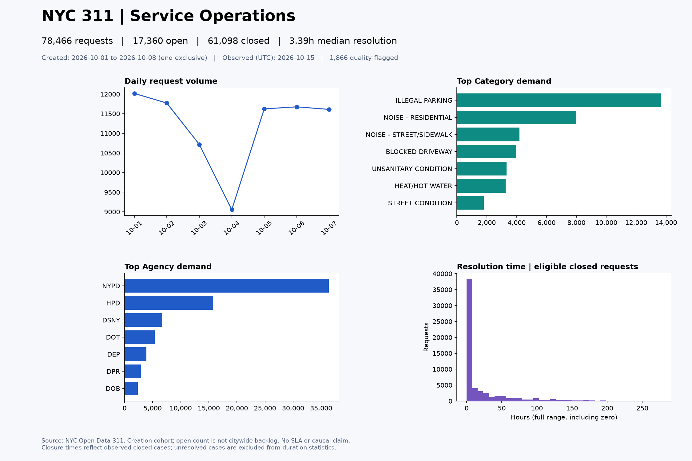

# Service Operations Analytics Pipeline

**NYC 311 requests, from API ingestion to traceable operational analytics with Python, SQL, DuckDB and a parallel dbt layer.**

[](https://github.com/RansiJ/service-operations-analytics-pipeline/actions/workflows/ci.yml)

[Run the dashboard locally](docs/dashboard.md#reproduce-locally) · [Recorded results](docs/results.md) · [Architecture](#architecture) · [Methodology](docs/data_dictionary.md) · [dbt guide](docs/migration/dbt_integration.md)

## Project at a glance

| Question | Implemented answer |
|---|---|
| What problem does it address? | Understand demand, observed closures and data-quality issues in a bounded NYC 311 creation cohort. |
| What did I build? | API extraction, RAW UPSERT and cohort tracking, SQL models, validation, ETL/ELT comparison, reproducible exports and an aggregate dashboard. |
| What does dbt add? | An experimental eight-model analytical DAG, tested in parallel against all six original SQL outputs on isolated synthetic snapshots. |
| What evidence is available? | 78,466 real requests created October 1–7, 2026; zero recorded ETL/ELT mismatches in a 1,000-request subset. Separate offline tests validate the dbt migration. |
| Stack | Python 3.12, SQL, DuckDB, dbt Core/dbt-duckdb, Requests, pytest, uv, Matplotlib, Plotly and GitHub Actions. |



*Authentic Matplotlib preview of the fixed cohort, observed October 15, 2026 at 00:32 UTC. The existing Plotly dashboard uses the same aggregate evidence. This is a historical snapshot, not live monitoring.*

The intended [GitHub Pages URL](https://ransij.github.io/service-operations-analytics-pipeline/) returned **404 on November 4, 2026**. Pages is configured for GitHub Actions, but the dashboard workflow is not yet on main and no Pages deployment was found. Use the local dashboard instructions below. Status: **ready for manual publication / not verified**. [Publication steps](docs/dashboard.md#publication-status-and-manual-steps).

## Architecture

```mermaid
flowchart TD
    subgraph original[Original operational pipeline]
        A[NYC 311 API / bounded window] --> B[Python extraction]
        B --> C[DuckDB RAW UPSERT + run membership]
        C --> D[Original transform.sql]
        D --> E[Requests / metrics / quality flags]
        B --> F[Small Python ETL subset]
        E --> G[QA + ETL/ELT comparison]
        F --> G
        G --> H[CSV + audit JSON + preview]
        H --> I[Existing aggregate Plotly dashboard]
    end
    subgraph parallel[Experimental dbt path / isolated test database]
        J[Deterministic fixtures + explicit run/snapshot] --> K[Original loader + SQL reference]
        K --> L[dbt staging]
        L --> M[Ephemeral classification]
        M --> N[Request fact + five marts]
        K --> O[Exact parity against six original outputs]
        N --> O
    end
```



The original Python pipeline remains the operational entry point. dbt is validated separately and is **not invoked by `pipeline.py`**. Its models cover normalization, lifecycle, overlapping quality rules, duration eligibility, global/daily/category/agency metrics and quality-rule frequencies. See the [model mapping and decisions](docs/decisions/ADR-002-dbt-model-migration.md).

## What this project demonstrates

- **Data engineering:** bounded keyset pagination, RAW evidence preservation, UPSERT and explicit run membership.
- **Analytics engineering:** dbt sources/refs, documented grains and denominators, modular SQL and exact model parity.
- **Data quality:** anomalous requests remain traceable; flags, missing values and eligible durations have explicit semantics.
- **Validation and reproducibility:** offline fixtures, rollback tests, repeatable exports, a pinned environment and an independent SQL reference.
- **Analytical communication:** request demand and observed closure distributions with scope, provenance and interpretation limits.

## Quick start

Run all commands from the repository root with Python 3.12 and [uv](https://docs.astral.sh/uv/getting-started/installation/).

### Offline tests and existing dashboard

```shell
uv sync --frozen
uv run --frozen pytest
uv run --frozen python -m service_analytics.dashboard
```

Open `site/index.html`. This path uses the committed aggregate evidence and never queries NYC 311. The dashboard's five figures use a local Plotly runtime; no server or CDN is required. The base environment works without dbt; optional dbt subprocess tests are explicitly skipped.

### Isolated dbt analytics

```shell
uv sync --frozen --group dbt
uv run --frozen --group dbt python -m service_analytics.dbt_poc prepare
uv run --frozen --group dbt dbt build --project-dir analytics --profiles-dir analytics --vars '{run_id: poc-selected, snapshot_id: poc-fixture-v1}'
uv run --frozen --group dbt python -m service_analytics.dbt_poc verify
uv run --frozen --group dbt pytest
```

Preparation creates a new `analytics/sandbox/service_requests_poc.duckdb` and refuses to overwrite files. On later runs reuse that known snapshot and omit `prepare`. Both dbt variables are mandatory. Use `--group dbt` on every experimental uv command. The [integration guide](docs/migration/dbt_integration.md) includes larger edge fixtures, connection checks and documentation/lineage generation.

**Phase 2 remains experimental:** dbt writes only to `dbt_staging` in the POC database. Verification compares all columns and types of the six original outputs, while checking that all ten original POC tables retain their fingerprints. These fixture results do not claim full-dataset migration or operational deployment.

### Live ingestion (separate, optional)

```shell
uv run --frozen service-analytics --start 2026-10-01 --end 2026-10-08 --max-records 100000
```

This command calls the public NYC API. Creation windows are start-inclusive/end-exclusive, 1–31 days, with a hard 100,000-row cap. Source changes can alter historical results or cause a bounded extraction to fail. [Operational commands, outputs and recovery semantics](docs/pipeline.md).

## Results and limitations

Recorded real-data cohort: **October 1–7, 2026**, observed **October 15 at 00:32:06 UTC** (October 14 at 18:32:06 in Costa Rica).

| Recorded indicator | Value |
|---|---:|
| Accepted requests | 78,466 |
| Open / closed / unknown | 17,360 / 61,098 / 8 |
| Eligible closure intervals | 61,053 |
| Median eligible resolution | 3.3908 hours |
| Requests with quality flags | 1,866 (2.3781%) |
| ETL/ELT subset mismatches | 0 of 1,000 |

[Original results and evidence](docs/results.md) document these figures. [Phase 2 validation](docs/validation/dbt_full_parity.md) records synthetic full parity. This branch configures separate base and dbt jobs on Ubuntu and Windows; the dbt job rejects skipped tests and verifies a fresh isolated database. Read hosted outcomes in the PR checks and [branch CI runs](https://github.com/RansiJ/service-operations-analytics-pipeline/actions/workflows/ci.yml?query=branch%3Afeature%2Fdbt-analytics-layer). The badge above reflects published `main`, independently of the feature branch. [Local checks and publication status](docs/validation/stabilization_phase2_5.md).

This is a creation cohort, not the citywide backlog. Resolution statistics exclude unresolved cases and depend on cohort age and request mix. Business dates are floating NYC wall-clock timestamps, making intervals near DST changes approximate. A closure is not evidence of satisfaction; no SLA, causal effect or agency-performance ranking is claimed.

RAW stores the latest payload observed for each ID. `run_members` identifies cohort membership, **not historical payload versions**. API count checks detect some changes during pagination but do not provide snapshot isolation. Quality flags can overlap and never silently remove otherwise identifiable requests. No native Power BI `.pbix` is supplied.

## Documentation and engineering decisions

- [Metric definitions, quality rules and provenance](docs/data_dictionary.md)
- [Original pipeline operation and exports](docs/pipeline.md)
- [Recorded real-data results](docs/results.md) and [dashboard scope](docs/dashboard.md)
- [dbt setup, model map and reproduction](docs/migration/dbt_integration.md)
- [Baseline audit](docs/migration/dbt_baseline.md), [ADR-001: engine choice](docs/decisions/ADR-001-dbt-integration.md), [ADR-002: model migration](docs/decisions/ADR-002-dbt-model-migration.md)
- [Full parity and regression results](docs/validation/dbt_full_parity.md)
- [CI stabilization, platform evidence and publication checklist](docs/validation/stabilization_phase2_5.md)
- [Power BI import specification](docs/power_bi.md) and [Unreleased changes](CHANGELOG.md)

Version remains **1.0.0**. Phase 3 must address writer coordination, snapshot policy, transaction/publication recovery and operational cutover before dbt can replace the original transformation path.
