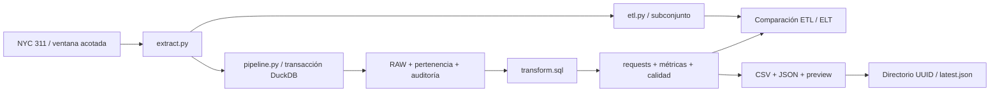

# Baseline anterior a dbt — fases 0 y 1

Auditoría local: **2 de noviembre de 2026**, Windows, Python 3.12.10, uv 0.12.7.
Versión del proyecto: **1.0.0**. No se publica ni declara 1.1.0.

## Estado de Git y preservación

Repositorio: `RansiJ/service-operations-analytics-pipeline`. Referencia original:
`5dc3143e476739d341ddb24d329ce6bfd9cef112`, en `main` al iniciar.
El árbol **no estaba limpio**. Se encontraron estos cambios anteriores:

| Estado inicial | Archivos |
|---|---|
| Modificados | `.gitignore`, `README.md`, `pyproject.toml`, `uv.lock` |
| Sin seguimiento | `.github/workflows/pages.yml`, `docs/dashboard.md`, `src/service_analytics/dashboard.html`, `src/service_analytics/dashboard.py`, `tests/test_dashboard.py` |

Los cambios previos incorporan Plotly, el dashboard y su publicación. No son parte
de la integración dbt. Se conservaron; README, dependencias, lock e ignore reciben
adiciones sobre ese contenido, sin restaurarlos a HEAD. No se hizo stash, reset,
commit, push, merge ni publicación remota. Se creó `feature/dbt-analytics-layer`
desde la referencia anterior, conservando el árbol de trabajo.

Antes de editar se inspeccionaron archivos seguidos y sin seguimiento, directorios
locales, SQL, Python, pruebas, documentación y los tres workflows. Se guardaron
localmente un diff binario y SHA-256 de 36 archivos, incluida la base operacional,
en `tmp/dbt_preexisting.patch` y `tmp/dbt_preexisting_state.json` (ignorados).
Estos auxiliares son evidencia de esta sesión y no son necesarios para reproducir
la POC.

`git tag --list` no devolvió tags. **Propuesta, no ejecutada:** después de revisar
que este commit representa el alcance deseado de 1.0.0, crear exclusivamente el
tag local `git tag -a v1.0.0 5dc3143e476739d341ddb24d329ce6bfd9cef112 -m "Baseline v1.0.0 before dbt"`.
El tag apuntaría al commit original, no incluiría los cambios pendientes del
dashboard y no debe reemplazar ningún tag existente. No se requiere para la POC.

## Arquitectura observada

| Componente revisado | Responsabilidad y comportamiento |
|---|---|
| `pyproject.toml` / `uv.lock` | Paquete Hatch, CLI `service-analytics`, Python >=3.12, dependencias y resolución reproducible. DuckDB 1.5.6 en el lock inicial. Plotly ya estaba agregado localmente. |
| `extract.py` | API JSON Socrata `erm2-nwe9`; selección explícita de campos y `:updated_at`; no descarga direcciones, coordenadas ni narrativas. |
| `pipeline.py` | Ventana, auditoría, carga RAW, transacción, SQL, QA, demo ETL, equivalencia, exportaciones, publicación y manejo de errores. |
| `schema.sql` | Cuatro tablas persistentes de RAW/auditoría; restricciones de claves. |
| `transform.sql` | Seis tablas analíticas mediante `CREATE OR REPLACE TABLE`; normalización, clasificación, flags y agregaciones. |
| `etl.py` | Transformación Python de fechas/estado antes de cargar `etl_demo`; conserva rechazos en su retorno. |
| `preview.py` | Matplotlib con backend Agg: vista PNG estática de resultados; no recalcula definiciones de métricas. |
| `tests/conftest.py` | Ocho entradas deterministas: siete IDs utilizables y un rechazo; fechas inválidas, intervalos negativos, estados inconsistentes y valores ausentes. |
| `tests/test_extract.py` | HTTP simulado, límites, paginación, reintentos, formas de respuesta y deriva de conteos. |
| `tests/test_models.py` | Semántica SQL/RAW, QA, métricas, ETL, UPSERT, pertenencia, rollback, exportaciones e idempotencia. |
| `docs/` | Diccionario de reglas/denominadores, resultados y evidencia histórica, especificación Power BI y documentación previa del dashboard. |
| `ci.yml` | Pruebas offline en Linux/Windows, build y smoke de recursos SQL en Linux. |
| `pipeline.yml` | Refresco público acotado manual/semanal; prueba primero y publica un artifact de outputs por 14 días. |
| `pages.yml` (previo, no seguido) | Dashboard de agregados mediante GitHub Pages; no consulta NYC 311. |

## Extracción, carga y relaciones

La ventana de creación es inclusiva al inicio y exclusiva al final, de 1 a 31
días. Se cuentan filas antes de descargar, se rechaza superar el cap (máximo
100.000), se pagina por `unique_key` **textual ascendente**, y se vuelve a contar
al finalizar. IDs ausentes, repetidos o no crecientes y ausencia de `created_date`
interrumpen la extracción. Hay tres intentos para errores transitorios con esperas
acotadas y timeouts de conexión/lectura. El API no ofrece aislamiento de snapshot
entre solicitudes: igualar conteos no demuestra ausencia de cambios concurrentes.

| Tabla / grano | Relaciones y semántica |
|---|---|
| `pipeline_runs` / una ejecución | PK `run_id`, ventana, UTC de auditoría, estado, conteos y error. |
| `raw_requests` / un ID | PK `unique_key`; cadenas originales, JSON, `fetched_at`, `last_run_id`. Último payload observado localmente. |
| `run_members` / ejecución e ID | PK `(run_id, unique_key)`; referencias lógicas a auditoría y RAW, sin foreign keys SQL declaradas. No almacena versiones del payload. |
| `raw_rejections` / entrada rechazada | Ejecución, número de fila, JSON y motivo `missing_identifier`. |
| `requests` / solicitud de la cohorte actual | JOIN RAW/pertenencia filtrado por `$run_id`; anomalías conservadas. |
| `metrics` / una fila | Totales y métricas globales de la cohorte actual. |
| `daily_metrics` / día solicitado | Incluye días sin solicitudes mediante date spine. |
| `category_metrics`, `agency_metrics` / etiqueta normalizada | Conteos, elegibilidad, mediana y calidad por grupo. |
| `quality_issues` / regla disparada | Cuenta solicitudes por flag; las reglas pueden solaparse. |
| `etl_demo` / ID del subconjunto | Fechas, lifecycle, horas y lista de incidencias de fecha/estado para comparación didáctica. |

`load_raw` escribe NDJSON temporal, conserva JSON original y admite únicamente IDs
de texto no vacíos. Cuarentena los demás. Dentro de un lote usa el último payload
por ID y cuenta duplicados. El UPSERT reemplaza los campos y la procedencia de IDs
ya conocidos; cada ID aceptado se añade a la pertenencia de esa ejecución.

**Consecuencia fundamental:** `last_run_id` indica la última observación, mientras
`run_members.run_id` selecciona IDs. Consultar una cohorte antigua después de un
UPSERT obtiene los valores actuales de RAW para aquellos IDs, no sus valores
históricos. Tampoco corresponde filtrar por `last_run_id` para elegir la cohorte.

## Normalización, métricas y calidad que se preservan

`TRY_CAST(NULLIF(trim(fecha), '') AS TIMESTAMP)` produce fechas de negocio NYC sin
zona; faltantes e inválidas quedan null. La procedencia de Socrata se convierte a
TIMESTAMPTZ y la observación se conserva. Se normalizan agencia, categoría y estado
con trim, colapso de whitespace y mayúsculas, en ese orden; fallback `UNKNOWN`.
`agency_name` sólo se recorta (fallback `Unknown`); borough se recorta y convierte
a mayúsculas sin colapsar espacios interiores. No se fusionan categorías.

`CLOSED` se clasifica closed; OPEN, IN PROGRESS, ASSIGNED, STARTED y PENDING como
open; otros como unknown. Una duración sólo es elegible en closed con ambas fechas
válidas y cierre >= creación. Cero horas es válido; no se exige ausencia de todos
los flags. La mediana se calcula sobre duraciones elegibles, sin imputar ceros ni
promediar medianas de grupos. Las bandas son [0,24), [24,72), [72,168), >=168 horas
y Unavailable. El porcentaje de calidad usa como denominador todos los IDs
aceptados, no las entradas extraídas ni el número de flags.

Las ocho reglas existentes son: fecha de creación ausente/inválida, cierre
inválido, intervalo negativo, cerrado sin fecha, abierto con fecha de cierre,
estado desconocido, agencia ausente y categoría ausente. Se conservan las filas
con flags; `is_valid` significa sólo ausencia de estas reglas.

El indicador diario requiere siete días anteriores, media >0 y volumen >=1,5
veces esa media. Es un marcador descriptivo, no un SLA ni un modelo inferencial.
QA comprueba IDs únicos, conteo cargado/modelado, particiones de estado y calidad,
ausencia de duraciones elegibles negativas y reconciliaciones por agencia,
categoría y día (excluyendo fechas inválidas de la suma diaria). Cohortes vacías
producen una advertencia, sin fallar por sí mismas.

## Transacciones, resultados y ETL/ELT

La auditoría inicial y conteos extraídos se registran antes de BEGIN. RAW,
pertenencia, transformaciones, QA, `etl_demo`, comparación y generación de outputs
en staging están dentro de la transacción. Los fallos hacen rollback; el registro
de ejecución fallida queda fuera del rollback. Tras COMMIT se renombra el directorio
staging a UUID, se actualiza `latest.json` y finalmente el estado success.
No hay transacción distribuida entre archivos y DuckDB: un fallo posterior al
COMMIT puede dejar datos confirmados con publicación incompleta/estado failed.

Se exportan ocho CSV ordenados, JSON con procedencia y SHA-256 y preview PNG.
Los directorios de éxito son inmutables. Evidencia agregada pequeña está versionada;
los datasets individuales y bases locales están ignorados. Artifacts de Actions
y la capa previa de Pages publican resultados sin que dbt participe.

La demo ETL procesa como máximo 1.000 filas por defecto (configurable 1..5.000).
Python parsea ISO flotante, clasifica estado y calcula duración antes del INSERT.
`compare_etl` compara fechas, lifecycle y horas de los mismos IDs contra ELT y
bloquea diferencias. No duplica todas las dimensiones ni todos los modelos.
Python rechaza fechas con zona de negocio; SQL usa TRY_CAST de DuckDB. Fuera del
contrato de fechas flotantes pueden existir diferencias de parsers; no se cambian
esas reglas en esta iteración.

## Baseline ejecutado antes de modificar archivos del proyecto

| Comando | Resultado real |
|---|---|
| `uv run --frozen pytest tests/test_extract.py tests/test_models.py` | **38 passed**, 3,29 s |
| `uv run --frozen pytest` | **60 passed**, 4,36 s; incluye 22 pruebas previas del dashboard |

Las pruebas usan HTTP simulado, fixtures y bases temporales. No se ejecutó el CLI
contra el API público. Las cifras históricas en `docs/results.md` y las ejecuciones
remotas enlazadas allí no se volvieron a validar en esta sesión. La diferencia
38/60 proviene de las pruebas previas del dashboard, no de dbt.

La fixture original comprueba siete aceptadas, un rechazo, estados 2/4/1
(open/closed/unknown), dos duraciones elegibles, mediana 1 hora y cuatro solicitudes
con flags. Los end-to-end offline comparan CSV agregados idénticos entre reruns;
las pruebas de fallos cubren extracción, SQL y exportación dentro de la transacción.

## Responsabilidades y propuesta de migración

| Conservar en Python | Candidatas a dbt en fases posteriores |
|---|---|
| HTTP, límites, reintentos, paginación | SELECTs de normalización con sources y refs |
| RAW UPSERT, rechazos y pertenencia | Clasificación, flags y elegibilidad de duración |
| Auditoría operativa y fijación de snapshot/cohorte | Tablas analíticas y dependencias del DAG |
| Política de transacción, bloqueo y recuperación | Tests de integridad y reconciliación equivalentes |
| Exportaciones, publicación, hashes y preview | Documentación de columnas y linaje |
| Demo ETL didáctica y comparación | No migrar la extracción ni la publicación a dbt |

La fase 1 añade sólo staging sobre datos sintéticos aislados. dbt organiza SQL,
materialización, tests y documentación; DuckDB sigue ejecutando las consultas.
uv conserva resolución reproducible; pytest aporta oráculo independiente ejecutando
la implementación original. No se añaden plataformas externas.

## Riesgos y controles

| Riesgo | Control inicial / trabajo pendiente |
|---|---|
| Perder atomicidad al lanzar dbt como proceso separado | No integrarlo en `run_pipeline`; diseñar protocolo de publicación/recuperación después. |
| Dos procesos escribiendo el mismo DuckDB | Base POC separada, conexiones cerradas entre procesos, un thread dbt; no equivale a resolver concurrencia operacional. |
| Selección implícita de última ejecución | Variables obligatorias run_id/snapshot_id, auditoría success y pertenencia exacta. |
| RAW mutable y pertenencia histórica | Snapshot conocido con huellas; no afirmar reconstrucción histórica. |
| Sobrescribir tablas originales | Base dedicada y esquema `dbt_staging`; checksums de todas las tablas originales de la POC. |
| SQL multi-statement, parámetros `$run_id`, DDL y lambdas específicos | Convertir sólo el SELECT normalizado a Jinja/source; diferir el resto. |
| Rechazar anomalías que antes se conservaban | No probar fechas no nulas, intervalos positivos ni listas cerradas de estados fuente. |
| Divergencia de normalización o motor | Mismo DuckDB del lock, comparación null-safe y filas/IDs exactos con el SQL original. |
| Nueva dependencia afecte instalación base | Grupo dbt opcional; comprobar entorno original sin ese grupo. |
| Diferencias Windows/Linux | Ejecutar localmente Windows; Linux sigue pendiente para dbt, sin cambiar workflows existentes. |

Ver [decisión de versiones](../decisions/ADR-001-dbt-integration.md) y
[implementación y validación de la POC](dbt_integration.md).
