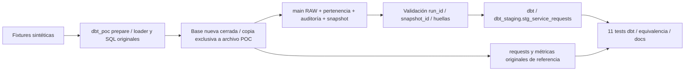

# Integración experimental de dbt — fases 0 y 1

Fecha de validación: 2026-11-02. Rama: `feature/dbt-analytics-layer`.
Versión del proyecto **1.0.0**, cambios bajo Unreleased. No hay publicación remota.

## Alcance y arquitectura

Antes: `extract.py → load_raw → transform.sql → QA → ETL/ELT → exports/preview` en
el orquestador Python y su transacción. Esa operación se conserva completa y no
necesita instalar dbt. El dashboard que ya estaba pendiente de commit se preserva.

Ahora se añade un camino **independiente**, exclusivamente con fixtures:



El preparador ejecuta `initialize`, `load_raw`, `transform_sql` y `check_quality`
existentes sobre una base temporal nueva. Cierra la conexión antes de copiar esa
base a un archivo nuevo con apertura exclusiva. No abre ni copia la base principal.
No es un importador de snapshots productivos ni una integración operativa.

Se crean dos cohortes: `poc-previous` contiene un ID externo y una versión anterior
de 101; `poc-selected` contiene siete IDs aceptados y un rechazo sin ID. El segundo
UPSERT actualiza 101, pero ambas pertenencias siguen existiendo. El ID externo
permanece en RAW y queda fuera de staging. Así se comprueba que RAW y pertenencia
tienen responsabilidades distintas.

El metadato `poc-fixture-v1` identifica la fixture documentada. Además guarda huellas
MD5 del contenido ordenado de RAW, pertenencia y auditoría y las huellas de todas
las tablas originales. Es una verificación local de integridad con el motor fijado,
no un historial de versiones ni una garantía criptográfica de autenticidad.

## Archivos y responsabilidades

| Archivo añadido | Responsabilidad |
|---|---|
| `analytics/dbt_project.yml` | Proyecto, versión de configuración, paths, materialización table y hook de validación. |
| `analytics/profiles.yml` | DuckDB local en esquema `dbt_staging`, un thread y UTC para procedencia/huellas. Sin credenciales. |
| `analytics/macros/poc_snapshot.sql` | Literales seguros, variables obligatorias, huellas y guardia de snapshot/run/archivo/esquema. |
| `analytics/models/sources.yml` | Tres fuentes RAW/auditoría documentadas y metadato adicional exclusivo de la POC. |
| `analytics/models/stg_service_requests.sql` | SELECT de normalización correspondiente al primer CTE original, cohorte explícita y trazabilidad. |
| `analytics/models/schema.yml` | Documentación de 14 columnas y tests genéricos de null/unique. |
| `analytics/tests/cohort_matches.sql` | Igualdad de IDs con la pertenencia en ambas direcciones y multiplicidad. |
| `analytics/tests/normalized_fields.sql` | Integridad básica de etiquetas, sin imponer validez de fechas/estados de negocio. |
| `analytics/tests/selected_run_consistent.sql` | Identidad de cohorte/snapshot y conteo auditado del modelo. |
| `analytics/README.md` | Inicio rápido y contrato de aislamiento. |
| `src/service_analytics/dbt_poc.py` | CLI separada prepare/verify, fixtures, checksums y comparación contra SQL original. No importa dbt. |
| `tests/test_dbt_poc.py` | Tres tests nuevos: protección de archivos, determinismo y subprocess dbt con equivalencia y fallos esperados. |
| `docs/migration/dbt_baseline.md` | Auditoría, baseline, cambios locales previos y riesgos. |
| `docs/decisions/ADR-001-dbt-integration.md` | Versiones, alternativas y justificación técnica con fuentes primarias. |
| `docs/migration/dbt_integration.md` | Esta guía, resultados, limitaciones y pendientes. |
| `CHANGELOG.md` | Cambios de esta iteración bajo Unreleased. |

Archivos modificados sobre sus cambios previos: `pyproject.toml` (grupo opcional),
`uv.lock` (resolución de ese grupo), `.gitignore` (artefactos dbt) y `README.md`
(sección experimental). No se modifican archivos originales de extracción, ETL,
orquestación, SQL, preview, dashboard, tests existentes ni workflows.

La versión dbt del proyecto también se deja en 1.0.0. Bases, WAL, logs, target,
packages y configuración local generada están ignorados. No se añaden datasets
individuales al control de versiones; las filas sintéticas sólo existen como
fixtures de código, igual que los tests originales.

## Instalación y ejecución reproducible

Con Python 3.12 y uv, **desde la raíz del repositorio**. Necesita acceso al índice
de paquetes para la primera instalación; los tests no necesitan el API NYC 311.
Estos comandos son válidos en PowerShell y Bash:

```shell
# Entorno y pruebas originales, sin instalar dbt.
uv sync --frozen
uv run --frozen pytest tests/test_extract.py tests/test_models.py
uv run --frozen pytest

# Dependencias opcionales fijadas por uv.lock.
uv sync --frozen --group dbt
uv run --frozen --group dbt dbt --version

# Crear una sola vez; falla si el archivo ya existe.
uv run --frozen --group dbt python -m service_analytics.dbt_poc prepare

# Cada proceso se ejecuta después del cierre de las conexiones del anterior.
uv run --frozen --group dbt dbt debug --project-dir analytics --profiles-dir analytics
uv run --frozen --group dbt dbt run --project-dir analytics --profiles-dir analytics --vars '{run_id: poc-selected, snapshot_id: poc-fixture-v1}'
uv run --frozen --group dbt dbt test --project-dir analytics --profiles-dir analytics --vars '{run_id: poc-selected, snapshot_id: poc-fixture-v1}'
uv run --frozen --group dbt python -m service_analytics.dbt_poc verify
uv run --frozen --group dbt pytest

# Generar catálogo, manifiesto y documentación/linaje local.
uv run --frozen --group dbt dbt docs generate --project-dir analytics --profiles-dir analytics --vars '{run_id: poc-selected, snapshot_id: poc-fixture-v1}'
```

En ejecuciones posteriores, omitir `prepare` y reutilizar la base conocida. Si la
alteró una herramienta, no sobrescribirla: preparar otra base nueva. `dbt build`
con los mismos parámetros es la alternativa a `dbt run` seguido de `dbt test`.
Las comillas simples y el mapping YAML entre llaves evitan problemas con JSON
y escape de comillas en PowerShell.

Para explorar el catálogo:

```shell
uv run --frozen --group dbt dbt docs serve --project-dir analytics --profiles-dir analytics --port 8080
```

Abrir la dirección local que muestre y terminar con Ctrl+C. Este servidor no se
arrancó en la validación: se comprobaron los artefactos, no la UI del navegador.
`analytics/target/index.html`, `manifest.json` y `catalog.json` se generan localmente.
El manifiesto registra dos dependencias directas del staging: RAW y pertenencia.
Auditoría y metadato se consultan en el hook, no como columnas fuente del SELECT.

### Otra ruta de prueba

`--database` de Python y `DBT_POC_DATABASE` de dbt deben referirse al mismo archivo.
Las rutas relativas se resuelven desde la raíz con el adaptador instalado.
Ejemplo PowerShell (elegir un nombre nuevo que no exista):

```powershell
$env:DBT_POC_DATABASE = 'analytics/sandbox/another_poc.duckdb'
uv run --frozen --group dbt python -m service_analytics.dbt_poc prepare --database $env:DBT_POC_DATABASE
uv run --frozen --group dbt dbt build --project-dir analytics --profiles-dir analytics --vars '{run_id: poc-selected, snapshot_id: poc-fixture-v1}'
uv run --frozen --group dbt python -m service_analytics.dbt_poc verify --database $env:DBT_POC_DATABASE
Remove-Item Env:DBT_POC_DATABASE
```

En Bash, usar `export DBT_POC_DATABASE=analytics/sandbox/another_poc.duckdb`, los
mismos comandos con `--database "$DBT_POC_DATABASE"`, y `unset DBT_POC_DATABASE`
al finalizar. No conservar variables que apunten a otra base al volver a los
comandos predeterminados. No hay rutas absolutas personales en configuración.

## Comportamiento y equivalencia

| Aspecto | Original | POC dbt |
|---|---|---|
| Selección | `$run_id` parametrizado, JOIN con run_members | Variable obligatoria escapada, mismo JOIN; no usa last_run_id para filtrar |
| Payload | Último observado en RAW | El mismo, fijado mediante snapshot conocido |
| Fechas negocio | TRY_CAST de cadenas a TIMESTAMP sin zona | Mismas expresiones; null/malformadas conservadas |
| Agencia/categoría/estado | trim → regex whitespace → upper; UNKNOWN | Mismo orden exacto; sin limpieza adicional |
| Nombre/barrio | Trim; nombre sin upper ni colapso, barrio con upper | Idéntico |
| Procedencia | TIMESTAMPTZ Socrata + fetched_at | Idéntico, más run_id/last_run_id/snapshot_id y texto original de cierre |
| Clasificación/flags/duración | En requests | No migrados; staging conserva lo necesario para la futura etapa |
| Métricas/exportaciones/transacción principal | Python + transform.sql | Sin cambios; dbt no participa |

`verify` compara cantidad, IDs y diez columnas compartidas mediante EXCEPT ALL en
ambas direcciones: request_id, fechas creada/cerrada, agencia, nombre de agencia,
categoría, barrio, estado fuente, actualización fuente y observación. La comparación
incluye nulls, tipos timestamp y precisión de microsegundos. Se verifican por separado
texto de cierre y tres columnas de trazabilidad. Las diez tablas originales de la
POC deben mantener sus huellas completas, incluidas las métricas y los flags.

No se impone created_at/closed_at NOT NULL, fechas en orden, estados en una lista
cerrada ni ausencia de flags. La normalización original puede dejar espacios al
colapsar tabs extremos después de trim; se preserva y se cubre en la fixture
ampliada. No se cambia una regla para obtener equivalencia.

## Pruebas y resultados reales

Entorno ejecutado: Windows 11, Python 3.12.10, uv 0.12.7, DuckDB 1.5.6,
dbt Core 1.12.6, adaptador DuckDB 1.11.1.

| Comprobación ejecutada | Resultado |
|---|---|
| Baseline original, antes de editar | 38 passed en extract/models; 60 passed en suite con dashboard previo |
| `uv lock` + `uv sync --frozen --group dbt` | Resolución e instalación correctas; ninguna versión de paquetes de HEAD fue actualizada |
| `dbt --version` | Core 1.12.6 / duckdb 1.11.1 |
| `prepare` predeterminado | 7 solicitudes seleccionadas, 8 RAW, 1 rechazo, 10 tablas originales de referencia |
| `dbt debug` | Conexión correcta a archivo POC y esquema separado |
| `dbt run` | Un modelo materializado correctamente; hook correcto |
| `dbt test` | **11 data tests passed**; el resumen incluye además el hook (PASS=12) |
| `verify` predeterminado | 7 filas, 10 columnas compartidas, 0 diferencias de filas/procedencia, 10 tablas originales intactas |
| Suite final con grupo dbt | **63 passed**, 51,37 s |
| Fixture original ampliada en subprocess dbt | **10 IDs**, cero diferencias; cubre microsegundos, UTC con offset, whitespace, faltantes, duplicados y anomalías |
| Repetir modelo sobre mismo snapshot | Filas completas idénticas |
| Guardias: variables omitidas, otra cohorte o snapshot desconocido | Comandos fallan como se esperaba, sin reemplazar el modelo por otra selección |
| Borrar una fila sólo de staging | `dbt test` falla por cohorte; `dbt build` restaura el modelo y pasa |
| Modificar RAW de la POC | Hook rechaza snapshot alterado y `verify` detecta cambio de tabla original |
| `dbt docs generate` | Genera index, manifest y catalog; se comprobó un modelo, 14 columnas y sus dos dependencias source |
| Entorno base tras `uv sync --frozen` | dbt ausente comprobado; **62 passed, 1 skipped**, 6,04 s |

La suite sin grupo dbt omite deliberadamente **sólo** el test que ejecuta subprocess
dbt. Los dos tests de preparación no importan dbt y siguen ejecutándose. Las 60
pruebas previas siguen siendo obligatorias y pasaron en ese entorno.

### Incidencias encontradas y resueltas

1. La ruta relativa del perfil se resolvió desde el CWD en el adaptador instalado,
   aunque la documentación indicaba profiles.yml. La primera conexión falló por ruta
   inexistente; se corrigió la ruta relativa y se exige ejecutar desde la raíz.
2. Una primera llamada `--vars` sin llaves era YAML inválido. Se documenta mapping
   con llaves entre comillas simples, verificado en PowerShell.
3. dbt avisó que `config` en profiles.yml está deprecado. La opción de telemetría
   se trasladó a `flags` en dbt_project.yml.
4. La primera ejecución del test nuevo esperaba que el error sin variables nombrara
   run_id. dbt evalúa snapshot_id antes en el SELECT; se corrigió la aserción y se
   comprueban ahora ambas variables ausentes por separado. Esa ejecución tuvo
   1 fallo/2 aciertos; la suite final corregida tuvo 63 aciertos.
5. `python -m dbt.cli.main` mostró un RuntimeWarning de runpy al consultar la versión.
   Los subprocess tests usan la entrada CLI Python directamente y las instrucciones
   de usuario usan el ejecutable `dbt` administrado por uv.

No hubo diferencias de normalización que requirieran cambiar reglas originales.
Los errores intencionales de guardias/corrupción se ejecutan sólo contra bases
temporales de pytest y son parte de una prueba satisfactoria.

## Límites y riesgos pendientes

- No se ejecutó NYC 311, ni se revalidaron datos reales, publicaciones o CI remotos.
- Linux no se ejecutó para dbt. Compatibilidad declarada y lock no sustituyen esa prueba.
- No se instaló/ejecutó dbt v2. Su evaluación fue documental, sin benchmarks.
- No se abrió visualmente el sitio de docs ni se probó `docs serve`.
- No se abrió ni se transformó la base principal; la verificación de no alteración
  se hace por SHA-256 del archivo completo frente al inicio, no por nuevas consultas.
- La POC no ofrece snapshots históricos RAW ni actualizaciones de datos reales.
- Los fingerprints completos son razonables para fixtures pequeñas, no un diseño
  de control para grandes volúmenes. Cambios de DuckDB requieren revalidación.
- Crear una tabla dbt es una transacción del adaptador, no parte de la transacción
  operativa Python. Un thread no sustituye política de bloqueo entre procesos.
- No hay exportación, scheduler, workflow dbt ni migración de quality_flags/métricas.
- `analytics/` se ejecuta desde el checkout; no se empaqueta dentro del wheel Python.

## Verificación final de preservación

Se reconstruyó el árbol previo aplicando el diff inicial a los blobs de HEAD en un
directorio temporal. Se comprobó que, al retirar únicamente la sección dbt, el
README coincide con el anterior; el pyproject y el ignore preservan sus contenidos
previos; todas las entradas anteriores de dependencias del lock permanecen iguales.
Los archivos originales restantes, incluidos los cinco archivos previos sin
seguimiento, mantienen sus SHA-256 iniciales. `git diff --check` no detectó errores.

La base operacional conserva exactamente el SHA-256 inicial:
`275a2b297b4b6a8438c6ade3dca0e885333c326c9bf38d5b29b55e46b183085a`.
No se abrió mediante DuckDB durante esta iteración.

La comprobación final `dbt build` también terminó correctamente: un modelo y once
tests, además del hook. `verify` volvió a dar cero diferencias y las diez tablas
originales de la POC intactas. Se regeneró la documentación con los archivos finales.

## Próximas fases — documentadas, no implementadas

2. Descomponer clasificación, flags, elegibilidad y marts en modelos con refs,
   comparando todos los resultados y denominadores contra snapshots equivalentes.
   Mantener el original como referencia hasta demostrar paridad completa.
3. Diseñar y probar coordinación de escritor DuckDB, cierre de conexiones,
   fijación de cohortes/snapshots, atomicidad, fallos y recuperación. Sólo entonces
   proponer invocar dbt desde la operación, manteniendo exportaciones compatibles.
4. Añadir validación dbt Windows/Linux a CI con razón y revisión concretas; documentar
   empaquetado/despliegue y revisar la elección Core/v2.
5. Revisar documentación, tag baseline y release estable. Considerar 1.1.0 únicamente
   cuando el alcance estable acordado esté probado; sin push/merge/release ahora.
